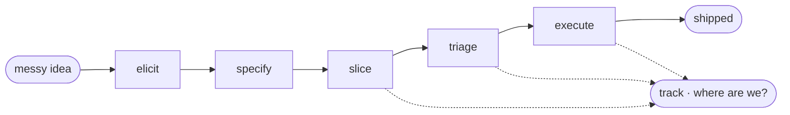
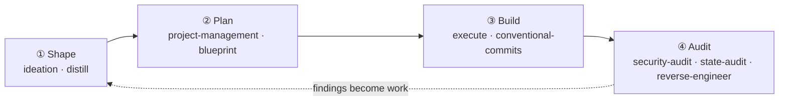

# Praxis

**Dev toolkit built through practice, not theory.**

A [Claude Code](https://docs.anthropic.com/en/docs/claude-code) plugin — agents and skills for the full journey from messy idea to shipped product.

- **Small and explicit.** Every skill is a readable Markdown file you can open, question, and adapt.
- **Composable.** Run a flow end to end, or grab one stage and ignore the rest.
- **No hidden process.** Big frameworks try to own your workflow, then go opaque when they break. These chain into a few well-defined flows you can see all the way through.

## Install (30 seconds)

```bash
claude plugin marketplace add 0x4139/praxis
claude plugin install praxis@0x4139
```

Or for local development:

```bash
claude --plugin-dir /path/to/praxis
```

No per-repo setup step. Skills that touch GitHub discover your repo's labels, milestones, and issue types at run time instead of asking you to configure them up front.

<details>
<summary><strong>Updating</strong></summary>

<br>

Installed plugins auto-update in the background, but only when the `version` in `plugin.json` changes — every release bumps it. To update manually:

```bash
claude plugin marketplace update 0x4139   # refresh the marketplace catalog
claude plugin update praxis@0x4139        # update the installed plugin
```

Run `/reload-plugins` inside Claude Code to activate the update in the current session; new sessions pick it up automatically.

</details>

## Why These Skills Exist

Three failure modes show up in almost every agent-assisted project. Each has a fix in this repo.

| | Failure mode | What it looks like | The fix |
|---|---|---|---|
| **1** | The agent built the wrong thing | You dump a half-formed idea, the agent fills every gap with its own assumptions, and three files later it turns out it never understood you. Worse: your "one idea" was four ideas glued together and it picked an arbitrary blend | [`distill`](./skills/distill/SKILL.md) — a guided pipeline that refuses to let anything stay silently assumed |
| **2** | The work only exists in chat | Decisions made in conversation evaporate when the session ends. The next agent — or the next you — re-litigates everything, and "what are we building?" has a different answer every week | [`project-management`](./skills/project-management/SKILL.md) — durable artifacts with traceable `REQ-`/`AC-` identifiers, specs in `spec/`, plans in `plan/`, real GitHub issues |
| **3** | The code drifts from your conventions | Agents write plausible code in *someone's* style, rarely yours. Every session reinvents error handling, naming, and test structure | Reference skills hold the conventions; review agents check work against them. You invoke neither — they activate when the task fits |

### The distill pipeline



Enter at any stage — arrive with a finished spec and it goes straight to slicing.

| Stage | What it does for you |
|-------|----------------------|
| **elicit** | Interrogates the messy dump in frontier rounds — splits "one idea" into the five ideas it really is, asks every currently-answerable question at once, and recommends an answer for each so you can accept a round in a few words. Facts get looked up by subagents; only *decisions* come to you |
| **specify** | Turns the conversation into a spec file. Does **not** interview again — it synthesizes what you already said |
| **slice** | Breaks the spec into vertical-slice tickets with native blocked-by edges, published in dependency order and grouped into milestones when phases emerge. Quizzes you on granularity before publishing anything |
| **triage** | Sorts existing issues into `ready-for-agent` / `ready-for-human` / `needs-info` / `wontfix`, verifying claims and writing agent briefs as it goes |
| **execute** | Works tickets off the frontier — blockers all closed — in an epic worktree. Solo by default, parallel agents on request |
| **track** | Standup, status, what's next, what's blocked. Computed live from GitHub's dependency graph, no local state files |

## The Flows

Skills compose into chains. The engineering spine runs left to right, and you can enter or leave at any phase:



| Flow | Chain |
|------|-------|
| **Idea → shipped** | [`distill`](./skills/distill/SKILL.md) — elicit → specify → slice → triage → execute, with **track** answering status at any point |
| **Spec → tracked execution** | [`project-management`](./skills/project-management/SKILL.md) — spec → plan → issues, then [`conventional-commits`](./skills/conventional-commits/SKILL.md) while you build |
| **Huge or multi-session work** | [`ideation`](./skills/ideation/SKILL.md) to diverge → [`distill`](./skills/distill/SKILL.md) to converge → [`blueprint`](./skills/blueprint/SKILL.md) for per-step context briefs across sessions |
| **Security** | [`security-audit`](./skills/security-audit/SKILL.md) — scope → model → hunt → verify → report, with **prove** and **patch** on request. The [`security`](./agents/security.md) agent is the continuous fast pass in between audits |
| **Hidden state** | [`state-audit`](./skills/state-audit/SKILL.md) — survey → chart → reach → decide, with **migrate** on request and **register** always. Hands off to [`blueprint`](./skills/blueprint/SKILL.md) when more machines need modelling than one session carries, or defers to [`debug`](./agents/debug.md) when there is one symptom to chase rather than an app to sweep |
| **Something you didn't build** | [`reverse-engineer`](./skills/reverse-engineer/SKILL.md) — frame → route → inventory → trace → record → close. Hands off to [`documentation`](./agents/documentation.md) for codemaps, or [`security-audit`](./skills/security-audit/SKILL.md) when the question turns to exploitability |
| **Fundraising** | [`market-research`](./skills/market-research/SKILL.md) → [`product-positioning`](./skills/product-positioning/SKILL.md) → [`go-to-market`](./skills/go-to-market/SKILL.md) → [`investor-memo`](./skills/investor-memo/SKILL.md) → [`investor-materials`](./skills/investor-materials/SKILL.md) → [`investor-outreach`](./skills/investor-outreach/SKILL.md) |
| **Content** | [`article-writing`](./skills/article-writing/SKILL.md) or [`academic-writing`](./skills/academic-writing/SKILL.md) → [`social-content`](./skills/social-content/SKILL.md) to repurpose, with [`unslop`](./skills/unslop/SKILL.md) as the final pass |
| **Media & motion** | [`product-explainer-video`](./skills/product-explainer-video/SKILL.md) — position → script → storyboard → produce → variants. [`slides`](./skills/slides/SKILL.md) for presentations |

## Reference

Everything splits on one axis: **who invokes it.**

| Kind | Who invokes it | How | Its job |
|------|----------------|-----|---------|
| **cmd** | You, or the agent when the task fits | `/praxis:<skill-name>` | Orchestrate — multi-stage pipelines that produce artifacts |
| **ref** | Agents, automatically | Loaded when the task is relevant | Hold the discipline — your conventions and patterns |
| **agent** | Dispatched autonomously as a subprocess | Never called directly | Review work against the conventions |

### Workflow Skills (cmd)

Call as `/praxis:<name>`.

**Engineering & planning**

| Skill | What it does for you |
|-------|----------------------|
| [`distill`](./skills/distill/SKILL.md) | Idea dump → elicit → specify → slice → triage → execute → track (see above) |
| [`project-management`](./skills/project-management/SKILL.md) | Formal specs, phased implementation plans, GitHub issues with sub-issues, dependencies, and milestones |
| [`blueprint`](./skills/blueprint/SKILL.md) | Multi-session construction plans — each step carries a self-contained context brief a fresh agent can execute cold |
| [`ideation`](./skills/ideation/SKILL.md) | Parallel divergent ideation — isolated subagent branches under different cognitive frames, then score, cluster, commit |
| [`harness-design`](./skills/harness-design/SKILL.md) | Specs for recurring agent workflows — roles, context boundaries, validation gates, failure recovery |
| [`adhd`](./skills/adhd/SKILL.md) | ADHD-friendly output mode — action-first, bounded steps, visible state |

**Audit & analysis**

| Skill | What it does for you |
|-------|----------------------|
| [`security-audit`](./skills/security-audit/SKILL.md) | Adversarial security audit — hunters find, a panel tries to refute, only survivors are reported |
| [`state-audit`](./skills/state-audit/SKILL.md) | Finds the state machines hiding in your app, proves which invalid states are actually reachable, then decides and migrates without conflating refactor with fix |
| [`reverse-engineer`](./skills/reverse-engineer/SKILL.md) | Works out what a shipped artifact does — binaries, app bundles, APKs, firmware, captures — and writes it down with evidence |

**Writing & media**

| Skill | What it does for you |
|-------|----------------------|
| [`article-writing`](./skills/article-writing/SKILL.md) | Blog posts, guides, tutorials, newsletters in a voice derived from your examples |
| [`academic-writing`](./skills/academic-writing/SKILL.md) | Research paper sections, paragraph flow, claim-evidence mapping, reviewer self-review |
| [`social-content`](./skills/social-content/SKILL.md) | Platform-native posts for X, LinkedIn, TikTok, YouTube, repurposed from long-form |
| [`unslop`](./skills/unslop/SKILL.md) | Strips AI tells from any prose — staging, triads, dashes, inflation, bold-label lists, chat residue — without losing a fact |
| [`product-explainer-video`](./skills/product-explainer-video/SKILL.md) | 30–90s explainer: position → script → storyboard → produce (HTML/Remotion) → social variants |

**Business & fundraising**

| Skill | What it does for you |
|-------|----------------------|
| [`market-research`](./skills/market-research/SKILL.md) | Competitive analysis, TAM/SAM/SOM, fund diligence with source attribution |
| [`product-positioning`](./skills/product-positioning/SKILL.md) | Differentiation diagnosis and one concrete positioning move (Purple Cow) |
| [`go-to-market`](./skills/go-to-market/SKILL.md) | GTM strategy from problem statement to launch plan |
| [`investor-memo`](./skills/investor-memo/SKILL.md) | Investment memos — founder-facing and VC-internal formats |
| [`investor-materials`](./skills/investor-materials/SKILL.md) | Pitch decks, one-pagers, financial models that stay internally consistent |
| [`investor-outreach`](./skills/investor-outreach/SKILL.md) | Cold emails, warm intro blurbs, follow-ups, update emails |

### Reference Skills (ref)

Loaded automatically. You never call these.

| Go | Discipline it holds |
|----|---------------------|
| [`go-standards`](./skills/go-standards/SKILL.md) | Naming, formatting, linting configuration |
| [`go-patterns`](./skills/go-patterns/SKILL.md) | Idiomatic Go patterns and conventions |
| [`go-backend`](./skills/go-backend/SKILL.md) | HTTP handlers, middleware, service layers, pgx |
| [`go-testing`](./skills/go-testing/SKILL.md) | Table-driven tests, benchmarks, fuzzing, TDD |

| TypeScript & web | Discipline it holds |
|------------------|---------------------|
| [`typescript-standards`](./skills/typescript-standards/SKILL.md) | Naming, typing, ESLint, project structure |
| [`bun-backend`](./skills/bun-backend/SKILL.md) | API routes, Zod validation, caching, middleware |
| [`bun-runtime`](./skills/bun-runtime/SKILL.md) | Bun as runtime, package manager, bundler, test runner |
| [`frontend-patterns`](./skills/frontend-patterns/SKILL.md) | React, Next.js, state management, performance |
| [`design-system`](./skills/design-system/SKILL.md) | Design tokens, visual consistency, UI auditing |

| Data & API | Discipline it holds |
|------------|---------------------|
| [`api-design`](./skills/api-design/SKILL.md) | REST conventions, pagination, error responses, versioning |
| [`postgres-patterns`](./skills/postgres-patterns/SKILL.md) | Query optimization, indexing, schema design, RLS |
| [`database-migrations`](./skills/database-migrations/SKILL.md) | Schema changes, zero-downtime deploys, sqlc |

| Ops & output | Discipline it holds |
|--------------|---------------------|
| [`docker-patterns`](./skills/docker-patterns/SKILL.md) | Compose, multi-stage builds, networking, security |
| [`conventional-commits`](./skills/conventional-commits/SKILL.md) | Structured commit messages with SemVer correlation |
| [`slides`](./skills/slides/SKILL.md) | HTML presentations from scratch or PPT conversion |

### Agents

Dispatched autonomously. You never call these either.

| Agent | Watches for |
|-------|-------------|
| [`api`](./agents/api.md) | API contract design, validation, client-server consistency |
| [`architecture`](./agents/architecture.md) | System design, scalability, technical trade-offs |
| [`database`](./agents/database.md) | PostgreSQL optimization, schema design, RLS, performance |
| [`debug`](./agents/debug.md) | Systematic root-cause analysis for bugs and test failures |
| [`documentation`](./agents/documentation.md) | Codemap generation, documentation freshness |
| [`frontend`](./agents/frontend.md) | Tailwind, component design, accessibility, responsiveness |
| [`go`](./agents/go.md) | Idiomatic Go — concurrency, error handling, performance |
| [`infra`](./agents/infra.md) | Kubernetes, Dockerfiles, CI/CD, deployment configuration |
| [`planning`](./agents/planning.md) | Implementation planning for complex features and refactors |
| [`security`](./agents/security.md) | Vulnerability detection, secrets scanning, OWASP Top 10 |
| [`tdd`](./agents/tdd.md) | Red-green-refactor enforcement |
| [`typescript`](./agents/typescript.md) | Type safety, async correctness, Node/web patterns |
| [`writing`](./agents/writing.md) | Architecture docs, memos, technical writing |

## Development

```bash
make help          # Show all targets
make validate      # Lint all skill and agent frontmatter
make list          # Show all agents and skills with descriptions
make install       # Symlink for local testing
make release       # Validate + bump version + tag + push
```

<details>
<summary><strong>Architecture</strong> — how Claude Code loads plugins, agents, and skills</summary>

<br>

<p align="center">
  
</p>

<p align="center">
  
</p>

</details>

## Why "Praxis"

From Ancient Greek **πρᾶξις** (*prâxis*) — "action" or "practice," specifically the kind of doing where you learn by doing. Aristotle distinguished three kinds of knowledge:

| Kind | Means | Where it shows up |
|------|-------|-------------------|
| **theoria** | Contemplation — knowing for the sake of knowing | Math, philosophy, cosmology |
| **techne** | Craft — knowing how to make things | Building, medicine, art |
| **praxis** | Knowledge from engaged action: act, reflect, adjust, act again | This repo |

The distinction that matters is praxis against techne. Techne produces an external product — a house, a sculpture. Praxis transforms the practitioner. The goal isn't an artifact, it's becoming better at the thing through doing it.

So this isn't a static template collection. It's a toolkit that evolves because you use it, notice what's missing, and refine it.

## Credits

Nothing here is copied verbatim. Each source below contributed an idea that was reimplemented in this repo's own voice; licences are noted where the source carries one.

| Skill | Source | Licence | What it contributed |
|-------|--------|---------|---------------------|
| `distill` | [mattpocock/skills](https://github.com/mattpocock/skills) | MIT | Frontier-round grilling, synthesis-without-reinterview, tracer-bullet tickets, triage states |
| `distill` | [automazeio/ccpm](https://github.com/automazeio/ccpm) | MIT | The execute and track delivery phases, rebuilt on GitHub's native dependency graph instead of local state files |
| `project-management` | [github/awesome-copilot](https://github.com/github/awesome-copilot) | MIT | Spec and plan templates |
| `product-explainer-video` | [gtmagents/gtm-agents](https://github.com/gtmagents/gtm-agents) | Apache-2.0 | The five-beat scriptwriting framework |
| `product-explainer-video` | [iart-ai/explainer-video-skills](https://github.com/iart-ai/explainer-video-skills) | MIT | Production workflow and verify scripts, vendored. Routes to the other [iart-ai motion packs](https://github.com/iart-ai/motion-skills) when installed |
| `security-audit` | [cloudflare/security-audit-skill](https://github.com/cloudflare/security-audit-skill) and its [harness write-up](https://blog.cloudflare.com/build-your-own-vulnerability-harness) | — | The coverage ledger, the two-mode gate, and the proof-against-an-untouched-tree rule |
| `security-audit` | [trailofbits/skills](https://github.com/trailofbits/skills) | CC BY-SA 4.0 | Invariants-before-vulnerabilities modelling, the refutation gates, and the `## Rationalizations to Reject` house pattern |
| `security-audit` | [google/mantis](https://github.com/google/mantis) | Apache-2.0 | Severity caps, wave-based hunting, and the barrier-not-transport rule |
| `security-audit` | [OWASP Secure Agent Playbook](https://github.com/OWASP/secure-agent-playbook) | CC BY 4.0 | The agentic and MCP attack class |
| `security-audit` | Anthropic's `claude-security` plugin and the `security-review` command shipped with Claude Code | — | The adversarial panel, the severity-versus-confidence split, and coverage-honesty reporting |
| `reverse-engineer` | [aicodeking/leanrea](https://github.com/aicodeking/leanrea) | MIT | The cost-ordered funnel, imports-as-capability-map framing, batched recon, and the slice-don't-cat context defense |
| `reverse-engineer` | [morluto/rea](https://github.com/morluto/rea) | MIT | The Observed/Inferred/Unknown contract, the rule against turning incomplete evidence into behavioral absence, summary-first drilling, and untrusted-target-content handling. Drivable as an optional MCP, never required |
| `state-audit` | A widely shared one-line prompt by [Steve Ruiz](https://x.com/steveruizok), October 2026 — *"find all of the implicit state machines in my app"* | — | The premise, and more usefully the objections to it: the reachability gate answers the reply asking for a real code path behind every suspicious transition, the three-verdict triage answers "some are normal and not worth changing", and the representation-versus-behavior split answers the "without breaking anything" clause the expanded prompt adds |
| `state-audit` | [Harel, *Statecharts*](https://www.sciencedirect.com/science/article/pii/0167642387900359) (1987) | — | Orthogonal regions over flat enums |
| `state-audit` | [Leon's "The Implicit State Machine"](https://leonsnotes.ca/2026/05/03/the-implicit-state-machine/) | — | The detection smells |
| `state-audit` | [Fowler, *Parallel Change*](https://martinfowler.com/bliki/ParallelChange.html) | — | Expand → migrate → contract, run over characterization tests |
| `state-audit` | [Netlify's Agent Experience principles](https://www.netlify.com/agent-experience/) | — | The AX criteria, read at codebase level |

## Contributing

Open an issue or PR. If you're adding a skill, run `make validate` before pushing.

## License

MIT
